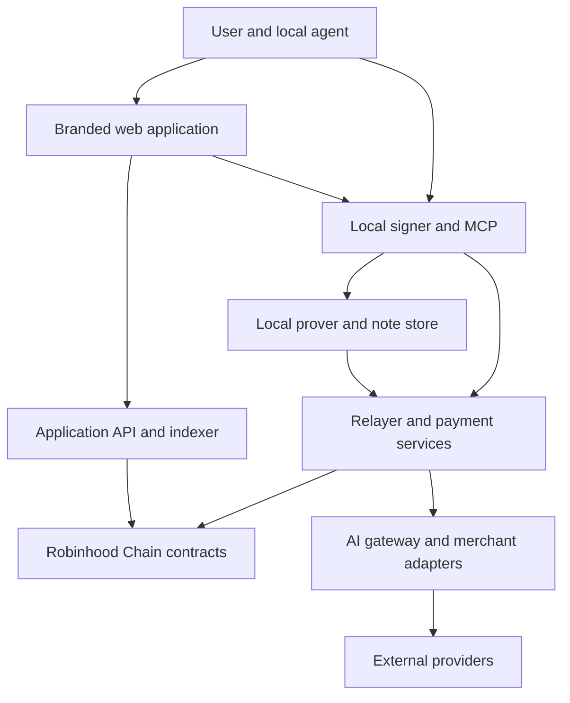

# Orven — Developer Brief for Robinhood Chain

**Prepared:** 1 November 2026, Asia/Makassar  
**Updated:** 2 November 2026, Asia/Makassar — product name confirmed as Orven  
**Status:** implementation brief for developer handoff  
**Product name:** Orven — name confirmed; domain, package scope and visual identity pending  
**Reference product:** https://app.ostraagent.xyz/  
**Network:** Robinhood Chain  
**Delivery target:** complete functional product, including web application, local agent tooling (MCP server), contracts, backend services, operations and documentation — full functional parity with the Ostra reference, per the owner's copycat-first directive.

> **Arahan pemilik produk:** Bangun Orven dengan cakupan fungsi lengkap seperti Ostra di Robinhood Chain. Gunakan source publik yang berlisensi sebagai dasar adaptasi. Frontend dan identitas produk memakai brand Orven. Tahapan di brief ini adalah urutan pengerjaan; fitur tidak boleh diam-diam dikurangi menjadi MVP. Developer harus menjelaskan dependency, keterbatasan, dan biaya tiap modul sebelum memberikan estimasi final.

This document specifies the product to build. It is not evidence that our implementation has been deployed, tested or audited. Requirements below are instructions for our product unless explicitly labeled as observations about upstream.

## 1. Product outcome

Build Orven, an agent-oriented financial and commerce platform on Robinhood Chain. A user can create and fund vaults, connect an AI agent through a local MCP server, pay for AI and services, trade publicly or through a private pool, create tokens, sell work, manage positions, and inspect activity through a branded web application.

The product must work as a coherent system. A frontend displaying upstream data without our settlement infrastructure is not delivery. Neither is a contract deployment without usable funding, recovery, quoting, settlement, indexing and operator tooling.

### Product surface clarification — web app (human users) + MCP (AI agents), both in scope

This was a real source of confusion across the team and is resolved here as the standing reference.

**Confirmed reference pattern (verified against upstream Ostra's own documentation, `docs.ostraagent.xyz/agents`):** Ostra separates two distinct, parallel paths — this brief follows the same split, as full functional parity requires both:

1. **Human users → web application**, connecting through a standard browser-extension wallet flow (observed: a Phantom-style connect on the reference docs/app surface). This is the primary surface most users interact with.
2. **AI agents → local MCP server** (`@ostraagent/mcp`-equivalent, published on npm, Node.js runtime). It runs on the agent's own machine; the agent's seed and one-time keys live there, not in a human user's browser session. This is how an agent programmatically acts on a user's vault.

**Decision:** build both, matching the reference exactly — this is the owner's confirmed direction (full copycat first, differentiating features later). Do not drop the MCP/agent layer; do not treat the web app as a lesser-priority deliverable either. Section 7 (WOTS signing) applies to both surfaces as specified; resolving how the browser-extension wallet flow handles WOTS-compatible signing (vs. relying on the agent-side MCP journal for agent-initiated actions) remains an implementation detail for the architecture workstream, not a reason to drop either surface.

### MCP package distribution — practical publishing guide

Once the MCP server is built and adapted from upstream (Section 2's pinned `ostra-robinhood/mcp` source), it needs to be published so AI agents/clients can fetch and run it via `npx`, matching the reference pattern. Steps:

1. **Create an npm account** for the organization — https://www.npmjs.com/signup, then verify the email.
2. **Register the npm scope/org** — https://www.npmjs.com/org/create, name it to match the confirmed package scope (e.g. `orven`). Public scoped packages are free; a private org requires a paid tier.
3. **Decide who holds publish access.** Treat this the same as the single-wallet-admin decision in Section 6 — name one accountable owner/account for npm publish rights, documented, not an ad hoc shared login.
4. **Set `package.json` for the MCP package**, matching the upstream pattern observed in the reference docs:
   ```json
   {
     "name": "@orven/mcp",
     "version": "0.1.0",
     "bin": { "orven-mcp": "./dist/cli.js" },
     "files": ["dist"],
     "engines": { "node": ">=22" }
   }
   ```
   Reconfirm the exact Node.js version requirement against the current upstream docs before locking this — the pinned commit in Section 2 recorded `>=24`, while the reference documentation page observed separately states `22` or later; resolve this discrepancy before release, not after.
5. **Bake in our own deployment records** before publishing — per Section 5, replace every upstream service URL, contract address, and deployment reference embedded in the package with Orven's own, and fail the build if an unapproved upstream endpoint survives into the published artifact.
6. **Publish:**
   ```bash
   npm publish --access public
   ```
   (`--access public` is required for scoped packages — they default to requiring a paid private tier otherwise.)
7. **Version and environment tagging:** since deployment records are baked into the package at publish time (not a runtime toggle), publish distinct releases per network using npm dist-tags, e.g.:
   ```bash
   npm publish --tag testnet   # package configured for chain ID 46630
   npm publish --tag latest    # package configured for chain ID 4663 (mainnet)
   ```
   A client then runs `npx @orven/mcp@testnet` or `npx @orven/mcp@latest` depending on which network it should target. Document this clearly for agent developers — picking the wrong tag means signing against the wrong chain.
8. **Subsequent releases:**
   ```bash
   npm version patch   # or minor / major
   npm publish --tag <testnet|latest>
   ```

This publishing step is a **mainnet-readiness-adjacent concern** but should be exercised on the testnet-tagged package well before the mainnet migration described in Section 6, so the publish/versioning workflow itself is proven before it matters for real funds.

### Confirmed product identity — Orven

- **Public product name:** Orven. Use this name in the web application, onboarding, installation guidance, product documentation and release materials.
- **Reference product:** Ostra. Orven is our independently configured and operated adaptation; upstream references are retained for implementation traceability and required attribution.
- **Scope:** the complete functional suite in this document remains required. The name change does not reduce features or alter the technical acceptance criteria.
- **Source identifiers:** repository URLs, pinned commits, upstream contract/class names, historical MCP tool names and license notices below remain unchanged as technical references. Map user-facing names and our tool namespace explicitly during implementation.
- **Cryptographic compatibility:** renaming the product must not trigger blanket replacement of signature domains, constants, proof inputs or artifact hashes. Follow the versioning and verification requirements in Sections 6, 7, 10 and 17.
- **Pending identity decisions:** domain, social handles, logo, visual palette, package scope and any protocol-token name/ticker. Orven as the product name does not imply that these identifiers are available or approved.

### Scope principles

- Deliver functional parity across the modules in Section 3. Record visual parity separately from functional parity.
- Reuse and adapt reviewed upstream code. Do not redesign the cryptography or write a new proof system to change branding.
- Deploy our own protocol instances and operate our own services where required. Explicitly approve any external dependency that remains shared.
- Keep signing secrets on the user's local client/device. Backend services must not require the master seed.
- Use the Orven brand with its own domain, package scope, metadata and assets. Preserve required source-license notices.
- Use real balances, quotes, fees, transaction receipts and job states. Demo data must be clearly identified and confined to demonstration environments.
- Keep the complete scope in the delivery tracker. Changes require a visible scope decision, not an unannounced omission.

### Scope boundary

The target is an application on Robinhood Chain. It does not require building a new blockchain, exchange matching engine, bridge, foundation model or cryptographic proving system. External providers and venues still require real integrations and verification.

## 2. Evidence baseline and source ownership

Pin these snapshots before implementation. Never estimate against an unpinned `main` branch.

| Repository | Reviewed commit | Primary use |
|---|---|---|
| [ostra-robinhood](https://github.com/ostraagent/ostra-robinhood/tree/475129bfe4f9d13227a65759c93bdeebc52ff43a) | `475129bfe4f9d13227a65759c93bdeebc52ff43a` | Vaults, signing, payments, MCP, relayer, indexing, launchpad, integrations |
| [ostra-swap](https://github.com/ostraagent/ostra-swap/tree/9b622cabff84b711d3048b560fd3188d39372723) | `9b622cabff84b711d3048b560fd3188d39372723` | Router, fees, orders, staking and STARK privacy stack |
| [ostrapad](https://github.com/ostraagent/ostrapad/tree/c46fee21a3130fb80ce22386b5faa729c9d7fc55) | `c46fee21a3130fb80ce22386b5faa729c9d7fc55` | Work marketplace contracts and settlement |

The three repository roots contain MIT licenses at this snapshot. Preserve notices in reused code and distributed copies. Produce a dependency-license inventory; a root license does not establish the license of every dependency, image, font or third-party service.

### Important gaps and version drift

1. **Web frontend:** a complete frontend implementation was not identified in these three public repositories. Plan to rebuild the web application. Before promising pixel parity, capture accessible reference screens and interaction states. The app returned HTTP 403 during read-only retrieval; this brief does not claim a screen-by-screen visual inspection.
2. **AI gateway:** its implementation is not supplied by these public repositories. Build an independent gateway with equivalent user capabilities.
3. **MCP launchpad changes:** current MCP has removed a number of launch creation and discovery tools, while launchpad contracts remain. Our requested full suite includes those flows; restore or implement their UI, SDK and MCP integration explicitly.
4. **Version drift:** reviewed MCP package is `0.1.16` and requires Node.js `>=24`. Some published documentation describes older releases. Use pinned manifests, source and reproducible tests to resolve differences.
5. **Vault V4:** source for V4 and venue controls exists in the reviewed core repository. Source presence does not prove that an upstream deployment uses that implementation. Verify the live beacon/implementation before describing deployment parity. Our release must explicitly state its implemented vault version.
6. **Legacy privacy:** the old fixed-denomination batch pool is documented as retired. The current privacy target is the STARK private pool. Do not revive the retired pool merely to fill a checklist.
7. **Deployment records:** treat upstream addresses and service URLs as reference inputs. Source, deployment JSON and live chain state may differ. Validate all three before reuse.

Developer must deliver `BASELINE.md`: pinned commits, toolchains, build results, test results, deployed-version checks, external dependencies, feature gaps and reproduction instructions. An inherited test suite is not an audit or a passing test result for our fork.

## 3. Complete feature and implementation matrix

| Module | Required product capability | Implementation approach | Completion evidence |
|---|---|---|---|
| Vaults and identity | Create/fund token vaults, balances, sends, withdrawals, identity/profile | Adapt core contracts, SDK and local signing | Independent funds round trip and identity lookup |
| Agent connection | Install/configure local MCP, tool discovery, signing and recovery | Adapt current MCP; restore required removed tools | Agent completes documented journeys against our services |
| Gas sponsorship | User pays bounded fees in supported token; relayer submits ETH transactions | Adapt relayer, quoting and fee accounting | Fee quote, settlement and relayer-float reconciliation |
| Payments | Direct payments, channels, x402, merchant acceptance, seller withdrawals | Adapt core/channel infrastructure and build merchant UI | Replay-safe voucher settlement and merchant payout |
| AI services | Text, image and asynchronous video; budgets, history, credits | Build gateway/provider adapters and UI | Real provider requests, actual costs and reconciled credits |
| Public swaps | Quote/execute across supported venues; history; split execution | Adapt swap SDK, aggregator and router | Real route, min-out protection and receipt reconciliation |
| Standing orders | Limit/take-profit/DCA capabilities supported by order contracts | Adapt escrow, keeper and cancellation/refunds | Fill, partial/failure behavior, expiry and refund tests |
| STARK privacy | Shield, note recovery, private balance/swap/unshield/withdraw | Adapt private pool, verifier, prover and local note handling | Proof verification, nullifier rejection and recovery tests |
| Launchpad | Create/discover tokens, buy/sell, metadata, pool configuration, referrals | Adapt launchpad/hook; restore removed MCP/SDK flows | Token lifecycle on our own deployments |
| Creator/token tools | Creator vault funding/withdrawal, dividends, airdrops, vesting | Adapt relevant current contracts/tools and implement UI | Independent claim/vesting/refund accounting |
| Work marketplace | Publish/search offers, order work, escrow, delivery/evaluation, disputes/payouts | Adapt Ostrapad contracts; build application services | Success, rejection, timeout and appeal journeys |
| Lending and strategies | Supported Borro/Morpho interactions, strategy controls, reports | Adapt verified integrations; independently verify venues | Deposit/borrow/repay/exit and risk-control tests |
| V4 venues | Supported Raeto/ERC-4626 entry/exit/forward, venue pins and breakers | Integrate source-present V4 after compatibility review | Versioned deployment and venue-change failure tests |
| Rewards | Tide-like registration/linking, scores, dashboard and funded distribution | Adapt applicable logic; configure our own program | Reproducible scoring and funded payout reconciliation |
| Web application | Branded flows for the entire suite; transaction/status visibility | Rebuild frontend with our API and local signer connection | Browser acceptance tests, mobile and accessibility review |
| Data and operations | Indexing, uploads, API, monitoring, administration and runbooks | Adapt reusable services and build missing operations | Reorg drill, restart recovery, reconciliation and incident drill |

If a third-party dependency is unavailable, document the exact blocker and proposed compatible alternative. Do not label a hidden button as implementation of the underlying feature.

## 4. Architecture and trust boundaries

Suggested implementation structure, subject to baseline verification:



The browser-to-local-signer mechanism is a design deliverable, not an assumption that MCP alone provides a browser wallet. Use a narrowly scoped local companion or an explicit wallet integration. Bind requests to the approved origin/session, require clear action intent, and prevent arbitrary websites from calling the signer. Do not expose an unauthenticated local HTTP signer.

| Component | Responsibility | Must not receive or control |
|---|---|---|
| Local signer/MCP | Seed derivation, WOTS journal, transaction intent, note ownership, bounded approvals | Operator secrets or unrestricted remote instructions |
| Web app | User flows, public state, clear confirmations, connection/status | Seed or private notes in analytics/server logs |
| Application API/indexer | Discovery, indexed events, history, uploads, jobs and notifications | Canonical signing authority |
| Relayer | Simulate, enforce supported calls, submit, reconcile and charge bounded fees | User master seed or ability to invent a signature |
| AI gateway | Payment reservation, provider dispatch, metering, jobs and credits | Unbounded access to a user's vault |
| Keeper | Execute eligible orders and maintenance | Permission to alter order terms or redirect refunds |
| Contracts | Funds, permissions, settlement and verifiable constraints | Reliance on UI-only safety checks |
| Prover | Produce proofs from locally held private inputs | Unnecessary transmission of note secrets to our server |

Keep local signing, operator authority and contract upgrade authority visibly separate. Document every privileged key and the actions it can perform.

## 5. Repository layout and stack

Preserve the sibling layout initially because upstream packages use relative local dependencies:

```text
project/
  upstream/
    ostra-robinhood/
    ostra-swap/
    ostrapad/
  apps/
    web/
    operator-console/
  services/
    application-api/
    ai-gateway/
  packages/
    product-config/
    api-contracts/
  deployments/
  docs/
```

This layout is proposed. Consolidate only after the inherited dependency graph builds reliably. Avoid package renaming and cryptographic domain changes in the same initial commit.

- **Contracts:** Solidity/Foundry; pinned compiler and dependencies from each repository.
- **SDK/MCP/services:** TypeScript and the pinned Node runtime. Reviewed core SDK/MCP require Node `>=24`; lockfile compatibility is authoritative.
- **Private proving:** Rust, locked Cargo dependencies, matching WASM build tools and reproducible artifact hashes.
- **Frontend proposal:** Next.js/React/TypeScript; a coherent responsive component system; optional GSAP for restrained transitions. Financial actions and status remain readable without animation.
- **Application storage proposal:** PostgreSQL for durable records, a queue for jobs, Redis only for suitable ephemeral coordination/cache. Do not make Redis the sole ledger or signing journal.
- **Observability:** structured redacted logs, metrics, traces, error tracking and deployment-version tags.

Upstream MCP packaging embeds deployment records, service URLs and prover assets/hashes. Inspect `mcp/scripts/pack.ts`. Replace these inputs for our product, generate a software bill of materials, and fail the build if production artifacts contain unapproved upstream endpoints.

## 6. Network, assets and deployment isolation

### Testnet vs mainnet — two modes, testnet is mandatory first

| | Testnet | Mainnet |
|---|---|---|
| Chain ID | `46630` | `4663` |
| Gas token | ETH (testnet) | ETH |
| RPC | `https://rpc.testnet.chain.robinhood.com` | `https://rpc.mainnet.chain.robinhood.com` (rate limited — use a production provider, do not rely on the public RPC for production load) |
| Explorer | official testnet explorer (check `docs.robinhood.com/chain/`) | `https://robinhoodchain.blockscout.com` |
| Funds | faucet/test funds, no real value | real funds, real value |

**Mandatory sequence:**

```
1. Deploy every contract to TESTNET first
2. Run the full test suite — unit, integration, and this brief's acceptance criteria (Section 25)
3. Validate the complete flow end to end: deposit -> trade/execute -> withdraw, success and failure cases
4. Only after everything passes cleanly on testnet -> migrate to MAINNET
5. Initial mainnet launch uses small controlled value, not full scale
```

Never deploy to mainnet before testnet passes completely. This is not just about saving gas — a contract bug still undiscovered on testnet can mean real user funds lost on mainnet.

### RPC access — use a VPN

Robinhood Chain RPC endpoints (testnet and mainnet) are frequently blocked by local ISPs (notably Indonesian ISPs). Before debugging "why is RPC not working," enable a VPN and retry — only treat it as a genuine endpoint/provider issue if it still fails with a VPN active. This applies to local development and to any CI/testing environment running from the same network; production hosting needs its own check for the same kind of blocking depending on provider/region.

### Token and contract addresses

| Token | Address | Notes |
|---|---|---|
| USDG | `0x5fc5360D0400a0Fd4f2af552ADD042D716F1d168` | 6 decimals — verify code and decimals on-chain before relying on this table |
| WETH | `0x0Bd7D308f8E1639FAb988df18A8011f41EAcAD73` | 18 decimals — verify the same way |

Recheck official network documentation (`https://docs.robinhood.com/chain/contracts/`) and on-chain state before deployment. Public RPC success does not establish archive availability, trace support or production capacity.

### Admin / ownership model — single wallet, not multisig

Orven uses a **single wallet admin**, not multisig — consistent with the precedent already used on the Counter project.

- The same wallet is used as admin/owner on both testnet and mainnet (do not switch wallets between environments).
- This means **no threshold approval** from multiple signers for admin actions (upgrades, pause, fee recipient changes, relayer/treasury control, etc.) — one private key holds full control.
- Implication for development: do not assume any multisig-voting delay exists anywhere in the trust-boundary design in Section 4. If a delay/timelock is actually needed, implement it at the contract level (a timelock contract), not by relying on multisig social consensus.
- **Risk to document for the owner:** single wallet = single point of failure. Given the scope here (vaults, relayer, launchpad treasury, marketplace escrow, upgrade authority), a leaked or lost key compromises everything it controls. Record this as an accepted, deliberate risk in the security/handover documentation (Section 25), not an oversight.

Create an independently versioned deployment manifest containing chain ID, start blocks, protocol version, factory, beacon/implementation, modules, router, private pool/verifier, hook, launchpad, marketplace, fee hub, staking, token, treasury, buyback, registry/venue references and code hashes. Include deterministic-deployment salts and initialization parameters where applicable.

Requirements:

- Separate local, fork, testnet, staging and production configurations and credentials.
- No upstream treasury, buyback token, upgrade owner, relayer, fee recipient or API URL may survive accidentally in our deployment.
- Reuse canonical network assets/registries only after verifying their identity and interface.
- Contract addresses affect CREATE2 predictions, deposit boxes, proof bindings and hook permissions. Recompute dependent values and fixtures after redeployment.
- Mine/check the required address bits for hooks where required by the underlying pool system. Do not assume any arbitrary deployment address is valid.
- A local fork may report the mainnet chain ID. Add explicit environment protection so test scripts cannot broadcast to real mainnet through a mistaken URL.
- Publish verified source and reproducible deployment instructions for our own contracts.

## 7. Vaults, keys, recovery and versioning

Adapt the upstream token-specific vault model and master-seed derivation. Support creation, funding, balance, transfer, withdrawal, profile/agent identity, optional guardians, lock configuration, linked vaults and safe recovery. Explain which vault owns each asset and which account pays gas.

### WOTS signing requirements

Preserve the reviewed one-time-signature construction and test vectors. Upstream uses a Keccak-derived WOTS construction; it must not be replaced with a new in-house design.

The central invariant is **one WOTS key must never sign two different messages**, including when the first transaction did not confirm. A chain nonce check alone does not enforce this off chain.

Implement and test:

1. An encrypted durable local journal, written before returning any signature.
2. Exclusive access across processes/tabs and explicit pending-operation ownership.
3. Exact signed-byte retries after timeouts, dropped submissions and RPC ambiguity.
4. Detection of incompatible backup restores and stale local state; fail closed until reconciled.
5. Explicit separation of successful spend, landed-but-failed action and fully reverted transaction.
6. No transaction retry that generates a different message with a previously used WOTS key.

Upstream signatures bind chain, vault, nonce, next key root, action and parameters. Preserve the existing domain for upstream test reproduction. If a new product domain is adopted for our fresh deployment, version it intentionally and regenerate all vectors, SDK fixtures and cross-language tests. Do not run a global text replacement over cryptographic constants.

### Permissions and recovery

- Implement guardian configuration, threshold/delay, support/request/cancel flows and recover-to-new-root flows.
- Implement optional withdrawal locks, delayed loosening, linked vaults, cancellation and guardian guard actions according to the selected contract version.
- Explain that a keyholder has broad authority unless a specific enforced control restricts it. Do not market generic per-agent spending policies that only exist in server/UI logic as on-chain guarantees.
- Exact-hash EIP-1271 approval is a separately authorized action. Never reuse a WOTS signature as an EIP-1271 signature, or expose arbitrary hash approval to untrusted agent content.
- A guardian backed by an ordinary EOA changes the security assumptions. The chain, bridge and asset issuers have their own cryptographic assumptions.
- Provide encrypted backup/export, restore rehearsal and an explicit explanation of unrecoverable states. Never imply support can recover an unknown seed without an authorized recovery path.

### Upgrades and V4

Inventory inherited ownership and delayed-upgrade mechanisms, then publish our privilege model. Delays are not proof of no admin power. Preserve an independently usable user exit path.

Include V4 venue actions in the full implementation plan: enable/disable venue, enter, exit and forward compatible foreign tokens to an eligible linked vault. Test storage layout, delegatecall boundaries, implementation/source/code-hash pins, loss handling, queued changes, rounding and guard/breaker exits. The allowed venue kinds in source include Raeto USDG, Raeto stock and ERC-4626.

Do not label V4 deployed until our own deployment and implementation checks prove it. A deliberate versioned activation is acceptable; omission without a scope decision is not.

## 8. Funding, gas relaying and payment channels

Support a simple user journey: create a vault, inspect its funding address and network, deposit the correct asset, wait for confirmation, then make a bounded payment or trade. Show pending funds separately from spendable funds. A sponsored transaction must show its token-denominated fee and maximum authorized total.

Adapt relayer preflight and submission with:

- Supported-contract/action allowlists and strict request validation.
- Client-verifiable fee bounds, simulation and transaction binding.
- Gas estimation including relevant L1 data costs; freshness checks for conversion oracles.
- Idempotency, signature escrow/pending state, receipt reconciliation and bounded retries.
- No generic arbitrary transaction/RPC passthrough from untrusted clients.
- Relayer ETH-float monitoring and accounting for fees recovered in tokens.

Implement direct payments, channel open/list/close, cumulative vouchers, merchant acceptance, seller balance and withdrawal. Enforce channel limits, expiry/closure rules, recipient binding and cumulative-delta settlement. Duplicate or out-of-order vouchers must not double-pay.

When using x402, implement the exact supported scheme and signing/payment verification. Test the complete challenge, payment, execution and retry sequence. A normal HTTP retry must not independently execute and charge the same job again.

Distinguish protocol fee, gas reimbursement and third-party service cost in both ledger and UI. Any configurable surcharge must be explicit and bounded.

## 9. Trading, routing and order execution

Required UI/agent capabilities: token search, balances, quote, swap, slippage, route details, price impact where computable, fee breakdown, recipient, minimum output, transaction state, order history and cancellation. Implement upstream split/order behavior only where the pinned code supports it, with documented semantics.

Routing requirements:

- Validate supported venues, pool hooks and tokens. Protect approval targets and final recipients.
- Bind executable route data to the user's intent, minimum output and applicable deadline.
- Refresh stale quotes and make insufficient liquidity an explicit result.
- Use real liquidity. Do not assume our own protocol token has a liquid buyback route.
- Reconcile actual balance changes and emitted failures. A landed transaction is not automatically a successful swap.
- Preserve defensive gas/revert-data behavior and refund routing in inherited execution code.

Order requirements:

- Clearly state that order escrow holds input funds until fill or cancellation/refund.
- Bound executor authority; no off-chain operator may change signed economic terms.
- Make keeper outages, expiry, duplicate execution, unfavorable prices and insufficient output safe.
- Test partial-fill behavior if supported; do not invent it if the contracts are all-or-nothing.
- Provide independent cancellation/refund instructions if our web app or keeper is unavailable.
- Do not call a feature “stop loss” unless a specific price trigger and execution mechanism implement it.

## 10. Privacy and proof execution

Use the current `ostra-swap` private-pool stack, including its circuit, verifier, Rust tooling, WASM assets and proof-binding rules. Preserve note commitments, nullifiers and value conservation. Deploy our own instance and regenerate compatible deployment artifacts.

Required flows: shield, private balance, recover owned notes, private swap, unshield, private withdraw and explicitly enabled auto-shield. Funding a private pool is an on-chain action; show its public receipt and fee.

Privacy wording must be precise: this design can conceal note ownership/linkage within its assumptions. It does not make the chain, token, transaction time, exposed amounts, swap pair or relayer invisible. Do not claim complete anonymity or guaranteed unlinkability for all deposit/withdraw patterns.

Implementation requirements:

- Keep private inputs and note secrets local by default; encrypted local persistence and recoverable scanning.
- Verify the complete public-input binding, including destinations, amounts, fees and call parameters.
- Reject malformed proofs, spent nullifiers and substituted recipients/routes.
- Validate artifacts by hash, pin proving/verifying versions and test browser/WASM compatibility.
- Benchmark proof latency, memory, calldata and gas using our build and target chain limits.
- Separate proof generation, relay submission and final settlement states. Preserve recoverability after browser/agent restart.
- Keep identifying analytics out of private-operation paths. Do not log witnesses, seeds or note contents.

Published upstream measurements indicate large proofs and expensive verification. Those figures are not our performance SLA. Set acceptance budgets from actual measurements before release.

The retired fixed-denomination batch pool is historical context. Provide compatibility/recovery handling only if an explicit supported legacy migration requires it; do not present it as the current privacy engine.

## 11. AI gateway — new implementation required

Implement independent text, image and video service access through the product's payment system. Existing public MCP client logic is useful, but it is not the missing server implementation.

Required gateway functions:

1. Provider/model registry with documented capability, price unit, limits and fallback policy.
2. Quote/maximum-price agreement and authenticated payment verification.
3. Atomic budget reservation before dispatch.
4. Idempotent provider execution using a stable client request identifier.
5. Usage collection, actual-cost calculation, settlement and unused-reservation reconciliation.
6. Async video jobs with polling/webhooks, duplicate-event handling, expiry and output delivery.
7. Credit balance/history, failed-request handling and operator reconciliation.
8. Provider rate limits, spending caps, timeout policy and circuit breakers.

Suggested internal states:

```text
quoted -> payment_verified -> reserved -> submitted -> running
running -> succeeded -> reconciled
submitted/running -> failed -> reconciliation_pending -> reconciled
```

Provider acceptance followed by a timeout is an unknown-result state, not permission to submit and charge again. Reconcile before retry or apply an explicitly safe idempotent provider mechanism.

Ledger amounts must use integer minor units. Store provider cost, product surcharge, reserved amount, captured amount, credit and settlement reference separately. The sum must reconcile. Do not describe prepaid service credits as immediately withdrawable cash unless withdrawal is actually implemented and funded.

Own API keys and provider billing accounts are required. Decide pass-through pricing versus markup explicitly. No model training is required to deliver these gateway capabilities.

## 12. Launchpad, creator tools and token lifecycle

Full scope includes creation and discovery as well as post-launch management. Current MCP source has removed these tool names:

```text
pool_info, quote_swap, buy, claim_referral, pairs, launch, launches,
tokens, token_info, publish_token_metadata, set_token_metadata,
set_pool_setting, set_creator_share, airdrop_fund, airdrop_start
```

Restore compatible functionality under our namespace. Historical code is an implementation reference, not automatically compatible with the current vault/signing API. Current `sell`, token-vault, creator, dividend, vesting and airdrop-management flows also remain in scope.

Required capabilities:

- Token creation, metadata upload, validation, preview, launch receipt and discovery.
- Pool configuration, tiers/liquidity, buy/sell, creator allocation and permitted configuration changes.
- Supported taxes, anti-sniping, anti-farmer and wallet/buy constraints, displayed accurately.
- Referrals and claims; creator vault funding/withdrawal and payout release.
- Dividend funding/accounting/claims; airdrop funding/start/claim/close; vesting information/release/dividend claims where supported.
- Profile and identity association, indexed token activity, real candles and receipts.

Preserve locked-liquidity and permitted-update constraints. Do not add an operator LP withdrawal capability that defeats the inherited model. Verify hook address permissions, callback authentication and token transfer behavior on both our pools and supported external routes.

Our launchpad requires our own configured contracts, treasury, fee sinks and token addresses. Existing external pools remain external liquidity. Do not assume their hooks can be replaced, or market our deployment as ownership of those pools.

Define handling for spam tokens, malformed metadata, hostile media, duplicate symbols, unsupported transfer behavior, blocked assets and missing liquidity. Distinguish a token being discoverable from being approved for routing.

## 13. Work marketplace and escrow

Adapt the Ostrapad work-escrow model and build the missing discovery/application layer. Support both compatible wallet-funded and agent-vault-funded paths where upstream supports them.

Required journey:

1. Provider publishes an offer, scope, price terms, identity and delivery format.
2. Client selects provider and evaluator mode, agrees immutable job terms and funds escrow.
3. Provider accepts/work starts according to the contract rules.
4. Provider submits a deliverable or artifact commitment.
5. Authorized evaluation approves or rejects within the applicable window.
6. Funds distribute, refund, enter a permitted appeal, or become claimable according to the contract state.

An artifact hash proves an artifact commitment; it does not prove useful work or evaluator honesty. UI must explain evaluator authority and whether a decision is appealable.

Implement fixed evaluator and bonded-pool modes where supported, including draw/commit-reveal, applicable appeal panels, fees, bonds, cooldowns, slashing, job expiry and all timeout transitions. Reproduce state-machine behavior from pinned contracts rather than inventing a simplified off-chain arbitration substitute.

Specific tests: no early payout, no double completion, no changed provider/evaluator after funding, correct cancellation/refund recipients, stalled reveal/evaluation/appeal handling, insufficient evaluator pool, and safe handling when a token pauses/freezes a transfer. Track deferred owed payments and allow the correct beneficiary to claim when possible.

Build searchable offers, job dashboard, delivery interface, evaluation interface, earnings, payout history and provider-limit progression. Reputation/reward logic must not treat self-dealing or wash jobs as independent customer activity.

## 14. Lending, strategies and external venues

Include the current Borro/Morpho-style tools, strategy planning/applying/checking/reporting, guard/breaker controls, and verified Raeto/venue capabilities. These are integrations, not evidence that the external service code belongs to our fork.

For each venue document:

- Chain, address, code/implementation, asset decimals, permissions and upstream owner/upgrade exposure.
- Position/share accounting, price source, collateral factors, health, liquidation and withdrawal restrictions.
- Enter/exit semantics, expected receiver, approvals, slippage/rounding and delayed configuration.
- Availability assumptions, API/login dependencies and whether yield is paid as tokens or service credits.
- Emergency route, loss behavior, source/implementation changes and breaker behavior.

Display realized and estimated values distinctly. Do not promise fixed yield, guaranteed withdrawals or automated strategy profit. Agent strategy recommendations must not bypass the user's approved scope or on-chain lock.

Test both ordinary exits and exits during provider/venue failure. V4's protections depend on the exact venue interface and observable state; a generic “ERC-4626 compatible” label alone is insufficient.

## 15. Rewards program and agent linking

Include a Tide-like rewards module with our own naming, rules and funding. Current upstream tooling supports agent/vault linking, points and a dashboard. We must not imply that our users qualify for upstream Ostra distributions.

Deliver:

- Registered-agent eligibility and signed/linking flow with explicit privacy semantics.
- Versioned scoring inputs, epoch boundaries, snapshot/correction rules and audit trail.
- Dashboard for points, estimated share, finalized entitlement and paid amount.
- Distribution tooling, funded treasury checks, retries and reconciliation.
- Anti-wash measures and clear handling of self-trades, self-jobs and fabricated activity.

Private linking secrets and dashboard capability URLs are sensitive. Do not emit them to analytics, public logs or referrer headers. An estimate must not appear as a funded claim. Token, budget, allocation and score weights remain owner decisions; implement configurable, testable mechanics before advertising rewards.

## 16. Frontend information architecture and UX

The following routes are a proposed organization for our app, not a claim that the reference uses these exact paths.

| Area | Suggested routes | Required screens and states |
|---|---|---|
| Entry | `/`, `/connect`, `/onboarding` | Product explanation, supported network, local agent/browser connection |
| Portfolio | `/dashboard`, `/vaults`, `/vaults/[id]` | Assets, funding, transfer, withdrawal, pending activity, positions |
| Protection | `/settings/security`, `/recovery` | Backup, guardians, locks, linked vaults, pending changes |
| Trading | `/swap`, `/orders`, `/activity` | Quotes, fee/slippage details, order creation, cancel/refund, receipts |
| Privacy | `/private` | Notes/balance, shield, proof progress, swap, withdraw, recovery |
| Launchpad | `/launch`, `/tokens`, `/tokens/[address]` | Creation, discovery, charts, trade, metadata and creator controls |
| Creator | `/creator`, `/airdrops`, `/vesting` | Funding, dividends, claims, schedule, earnings and payouts |
| Work | `/marketplace`, `/offers/[id]`, `/jobs/[id]`, `/earnings` | Search, publish, escrow, delivery, evaluation, dispute and payout |
| AI | `/ai`, `/ai/jobs/[id]`, `/credits` | Provider/tasks, max price, output, async jobs, credit history |
| Strategies | `/strategies`, `/positions` | Venue selection, risk, strategy actions, checks and exits |
| Rewards | `/rewards` | Eligibility, linking, scoring, epochs and claims/payout status |
| Developers | `/agents`, `/developers` | MCP setup, tool capabilities, merchant integration, API docs |
| Operations | separate operator access | Service health, reconciliation, failures and controlled administration |

Every financial screen must handle disconnected, wrong-network, loading, empty, insufficient balance, fee change, simulation failure, awaiting signature, submitted, confirmed, failed and recoverable/unknown states. Show the actual transaction hash and chain explorer link when available.

Include responsive mobile layouts, keyboard access, readable numbers, token decimals, explicit units, UTC timestamps with local display, and an accessible reduced-motion experience. No infinite spinner after an unreconciled transaction.

Produce a reference-capture inventory and a screen/state parity checklist. Acceptance is based on captured references and this specification; do not promise “100% identical” before the reference states can be inspected.

## 17. MCP tool compatibility

Use the current upstream inventory as a migration checklist. Namespace may change, but maintain a documented old-to-new mapping and machine-readable tool schemas. Do not rely on a tool count as the parity measure.

| Group | Observed current tool names to account for |
|---|---|
| Vaults/payments | `open_vault`, `balance`, `withdraw`, `open_channel`, `list_channels`, `close_channel`, `pay`, `accept_payments`, `seller_balance`, `seller_withdraw` |
| AI | `ostra_ai`, `ostra_ai_job`, `ostra_ai_credit` |
| Swaps | `ostra_swap_quote`, `ostra_swap`, `ostra_swap_orders`, `ostra_swap_split` |
| Privacy | `private_shield`, `private_recover`, `private_balance`, `private_swap`, `private_unshield`, `private_withdraw`, `auto_shield` |
| Recovery | `recovery_status`, `set_guardian`, `set_recovery_policy`, `cancel_recovery`, `support_recovery`, `request_recovery` |
| Lending | `borro_markets`, `borro_position`, `borro_lend`, `borro_withdraw`, `borro_collateral`, `borro_borrow`, `borro_repay` |
| Protection | `vault_lock`, `vault_link`, `vault_revoke_hash`, `guard_vault` |
| Strategies/venues | `strategy_plan`, `strategy_apply`, `strategy_check`, `trading`, `strategy_report`, `raeto`, `breaker` |
| Work | `pad_publish`, `pad_search`, `pad_order`, `pad_jobs`, `pad_deliver`, `pad_evaluate`, `pad_earnings` |
| Rewards | `tide` |
| Creator/token | `sell`, `token_vault`, `transfer_token`, `claim_dividends`, `fund_creator_vault`, `creator_withdraw` |
| Identity/uploads | `profile`, `upload_image`, `publish_profile`, `release_creator_payout` |
| Distribution | `airdrop_claim`, `airdrop_close`, `vesting_info`, `vesting_release`, `vesting_claim_dividends` |

Add the restored launchpad tools from Section 12. Include V4 coverage through verified existing tools or an explicitly documented extension. A tool is complete only if its real backend/contract path works.

Treat prompts, merchant descriptions, token metadata, deliverables and model output as untrusted content. They must not acquire permission to change recipients, approve hashes, increase spend limits, export secrets or execute arbitrary shell commands. Translate user intent into typed, allowlisted actions with bounded economic parameters.

## 18. APIs, data model and indexing

Define versioned schemas before independent frontend/backend implementation. Publish OpenAPI for HTTP interfaces and JSON schemas for tool inputs/results. Endpoint names below are design categories, not claims of existing upstream endpoints.

| API area | Required contract |
|---|---|
| Configuration | Chain, supported assets, contracts, versions, capabilities and maintenance flags |
| Portfolio/activity | Indexed balances/positions, pending actions, receipts and freshness indicators |
| Quotes/relay | Request ID, bound action, fee ceiling, signed payload, submission and reconciliation |
| Orders | Terms, escrow, eligibility, execution status, cancellation and refunds |
| AI/jobs | Quote/reservation, payment reference, async state, output, usage and credits |
| Marketplace | Offers, terms hash, escrow ID, delivery/evaluation/appeal state and payouts |
| Tokens/creator | Metadata, launch receipts, pools, trades, candles, claims and distributions |
| Rewards | Linking capability, score version, epoch snapshot, finalized entitlement and payment |
| Operations | Authenticated health, reconciliation, queues and safe administrative actions |

Core records: network/deployment, vault, agent/profile, operation intent, relay request, transaction/receipt, payment channel/voucher, ledger entry, AI reservation/job/usage, offer/job/evaluation/appeal, order/fill, token/pool/trade/candle, reward epoch/score/payment and uploaded artifact metadata.

Indexing requirements:

- Key records by chain and deployment version, not just address.
- Persist block number/hash, transaction hash and log index; deduplicate idempotently.
- Support reorg rollback/replay and distinguish observed from sufficiently confirmed state.
- Make contract state canonical for funds and permissions; indexed state is a query layer.
- Store source block/time and freshness indicators for derived balances and quotes.
- Backfill within RPC log limits; document archive/trace requirements.
- Keep private note stores and linking secrets out of the public index.
- Use content hashes, MIME/size checks and safe rendering for uploads; do not execute uploaded HTML/scripts.

Ledger entries must be immutable or reversed by explicit compensating entries. Every paid operation must reconcile to contract events, provider charges or a documented outstanding liability.

## 19. Economics and capital requirements

The product does not require us to act as counterparty to every user trade. User funds pay for user activity, and swaps can route through external liquidity. However, operating the system is not cost-free.

Budget for deployments, relayer ETH float, provider billing/prepayments, RPC/indexing, storage, proving/compute, keeper execution and any rewards or launch liquidity we choose to fund. A new protocol token and its buyback route need actual token/liquidity decisions; they do not appear automatically after a fork.

### Reference parameters to evaluate, not automatically approved economics

| Area | Upstream reference behavior/parameter | Our implementation requirement |
|---|---|---|
| Launch creation | Source defines `0.0002 ETH` launch fee and a fixed supply constant | Test inherited behavior; owner approves our final parameters |
| Launch hook | Reference base hook fee is 1%; creator/protocol split is separate from LP fees and optional taxes | Show separate components; preserve accounting and configurable recipient decisions |
| Creator/protocol allocation | Reference split is 70% creator / 30% protocol; half of protocol share allocated to buyback | Treat as shares of the hook fee, not percentages of trade value |
| Router fee/staking | Reference base 20 bps; stake tiers reduce public-route fee | Verify each route; choose our token and tiers explicitly |
| Stake tiers | Reference 100k/250k/500k tokens for 15/10/0 bps, with 7-day lock | Check decimals and beneficiary rules; do not reuse upstream token accidentally |
| Private-route fee | Reference private swaps retain the base fee | Display the effective fee for that path |
| Work platform fee | Source defines 50 bps on applicable successful settlement | Keep evaluator/appeal charges separately accounted |
| Gas relay | Reference uses estimated gas/data cost with surcharge and conversion bounds | Quote clearly; fund ETH float and reconcile actual settlement |
| AI | Product may use pass-through or an explicit markup | Decide pricing and disclose provider cost/product fee behavior |
| Rewards | Requires a funded program | No unfunded claim balance or implied guaranteed airdrop |

Developer must extract final constants from the pinned source into `ECONOMICS.md`, including tax/anti-sniping bounds, tier counts, evaluator bonds, fee minima, time windows, cooldowns and all recipients. Test boundary values. Do not copy dollar amounts without respecting asset decimals.

Revenue reporting must distinguish gross fees, creator/evaluator shares, gas reimbursement, provider costs, buyback allocation and net treasury receipts. User deposits, job escrow, note-pool balances and unspent credits are not platform revenue.

## 20. Security invariants and meaningful verification

Reproduce upstream tests before making functional changes. Record commands, compiler/runtime versions, environment, commit and results. Then add tests for our changes and deployment-specific integrations.

| Area | Required invariants and failure cases |
|---|---|
| Signer | No different-message WOTS reuse; durable journal; concurrent processes; stale restore; identical-byte retries |
| Vault | Domain/chain binding, unauthorized calls, nonce/root rotation, reentrancy, correct failure semantics and recovery |
| Locks/guardians | Delayed loosening, tightening, cancellation, recovery-in-progress, stolen-key scenarios and independent exit |
| Relayer | Fee caps, malicious destination, stale oracle, duplicate requests, out-of-gas and ambiguous RPC/receipt outcomes |
| Channels/x402 | Replay, cumulative amounts, expired/closed channel, duplicate HTTP requests and settlement races |
| Swaps/orders | Slippage, stale quotes, hostile hooks/tokens, failed fills, refunds, keeper downtime and recipient binding |
| Privacy | Invalid proofs, nullifier reuse, substituted fields, note recovery, artifact mismatch and value conservation |
| AI | Reserve/capture/credit conservation, unknown provider usage, duplicate callbacks, billing failures and timeout recovery |
| Launchpad | Creation/pool initialization, hook permissions, fee splits, tax limits, locked liquidity, creator claims and vesting |
| Marketplace | Full state machine, timeouts, bad evaluators, appeals, bonds, blocked payouts and no double settlement |
| Venues | Code/source/implementation changes, bad asset/share accounting, losses, rounding, breaker and guard exits |
| Indexer | Reorgs, duplicate logs, restart/backfill and deployment separation |
| Rewards | Reproducible score, sybil/wash cases, private-link secrecy and funded payout totals |
| Frontend | Full critical journeys, clear status, wrong network, disconnect/reconnect, mobile and keyboard navigation |

Use local and fork tests with non-production secrets. Review code before enabling Foundry FFI. Fork tests must never have access to a funded deployment key by default.

Commission independent review for changes affecting keys, vault storage, upgrades, settlement, hooks, privacy bindings and fee routing. Publishing an inherited security page is not evidence of an audit of our product.

## 21. Build and baseline workflow

Developer's first sequence:

1. Clone all three repositories, initialize submodules, check out the exact commits and preserve licenses.
2. Inventory manifests, toolchains, dependency links, generated ABIs and prover assets.
3. Reproduce contract, SDK, MCP and Rust/prover builds independently of our branding changes.
4. Run the available upstream suites and document any RPC/fork dependencies or existing failures.
5. Generate a deployment/address/privilege/service inventory.
6. Mark every upstream endpoint, token, owner and recipient that must change.
7. Design the local signer/web connection and API boundaries before frontend implementation.
8. Produce a module estimate based on the reproduced baseline and measured gaps.

Example snapshot acquisition; follow the pinned READMEs for the complete build sequence:

```bash
mkdir -p project/upstream
cd project/upstream
git clone --recurse-submodules https://github.com/ostraagent/ostra-robinhood.git
git clone --recurse-submodules https://github.com/ostraagent/ostra-swap.git
git clone --recurse-submodules https://github.com/ostraagent/ostrapad.git
git -C ostra-robinhood checkout 475129bfe4f9d13227a65759c93bdeebc52ff43a
git -C ostra-swap checkout 9b622cabff84b711d3048b560fd3188d39372723
git -C ostrapad checkout c46fee21a3130fb80ce22386b5faa729c9d7fc55
git -C ostra-robinhood submodule update --init --recursive
git -C ostra-swap submodule update --init --recursive
git -C ostrapad submodule update --init --recursive
```

Relevant baseline entry points include Foundry contract tests, SDK typechecking/tests, core test vectors, MCP packaging, swap Rust/WASM prover builds and privacy/fork tests. Preserve locked dependencies; do not resolve this task by blindly updating all libraries to their latest releases.

## 22. Infrastructure, deployment and runbooks

Choose hosting after measuring CPU, memory, background-job and persistent-storage requirements. A web-oriented platform may host the frontend/API while long-running keepers, archive indexing or proving workloads need separate services. No particular hosting vendor is mandatory.

Production requirements:

- Separate RPC provider credentials and fallback/read consistency policy.
- Durable database, migrations, backups and tested restoration.
- Durable queues or equivalent job ownership, retry/dead-letter handling and idempotent consumers.
- Correct persistent signer storage on user devices; never depend on an ephemeral server filesystem for user key recovery.
- Secret manager for operator/provider keys, scoped service authentication and key rotation.
- Alerts for relayer ETH balance, fee deficits, stuck transactions, provider spending, reserve/credit mismatch, stale indexing, failed proofs and order backlog.
- Circuit breakers for new risky actions without unnecessarily blocking independently authorized withdrawals/claims.
- Signed/versioned releases and artifact hashes, especially for local tooling and prover binaries.
- Explicit upgrade scheduling, timelock monitoring, dependency checks and rollback/recovery plans.

Runbooks must cover RPC outage, reorg, relayer compromise, low gas float, duplicate submission, database restore, stale signer state, provider billing outage, privacy recovery, keeper outage, blocked token payouts, contract upgrade and emergency user exit.

No mainnet launch should depend on the original Ostra operator keeping an undocumented service online.

## 23. Workstreams and ownership

These are responsibility areas, not a required headcount. A developer may own multiple areas, but every area needs a named owner and reviewer.

| Workstream | Accountable output | Critical dependencies |
|---|---|---|
| Protocol/contracts | Fork, deploy, verify, economics, upgrades, hooks and escrow | Baseline reproduction; deployment and security decisions |
| SDK/local signer/MCP | Signing journal, device connection, tools and recovery | Versioned contract ABIs; local security design |
| Backend/payments | Relayer, channels, gateway, ledger, queues and APIs | Contract settlement and provider billing |
| Trading/privacy | Routes/orders, keepers, prover artifacts and note flows | Liquidity, RPC, circuit/verifier compatibility |
| Data/marketplace | Indexer, discovery, uploads, jobs, rewards and reconciliation | Event schemas; provider/evaluator flows |
| Frontend/design | Full web flows, mobile, visual system and reference parity | API contracts and signer connection |
| QA/security/operations | Independent verification, observability and release drills | Deployable complete environment |

## 24. Milestones and reviewable deliveries

Milestones sequence the complete product; they do not replace it with a smaller release. Parallel work is acceptable once interfaces are stable.

| Milestone | Deliverable | Exit criteria |
|---|---|---|
| A — Reproduced baseline | Pinned fork, build report, feature/dependency/license map | Available suites reproduced; gaps and unknowns documented |
| B — Own core environment | Manifest, deployments, SDK, local signer, relayer and indexer | Fund/send/withdraw/recover using our services and addresses |
| C — Payments and AI | Channels, x402, merchants, new AI gateway and ledger | Real payment/provider round trip with failure reconciliation |
| D — Trading and privacy | Router, orders, keeper, private pool/prover and UI | Public/private trade and order cancel/refund journeys proven |
| E — Launchpad and creators | Full launch restoration, metadata, claims and distributions | Launch-to-trade-to-creator/claim lifecycle proven |
| F — Work marketplace | Offers, escrow, delivery, evaluator modes and disputes | Successful, rejected, timed-out and appealed job journeys |
| G — Positions and rewards | Lending/strategies, V4 venues, linking/scoring/payouts | Entry/exit/breaker and funded epoch distribution proven |
| H — Release readiness | Complete frontend, review fixes, monitoring and runbooks | Full acceptance matrix, recovery drills and owner decisions closed |

After Milestone A, estimate each workstream with dependencies, staffing, external costs, uncertainty and critical path. Distinguish inherited-code adaptation from missing-service implementation. Avoid a single optimistic deadline that assumes the frontend, AI gateway and deployment wiring already exist.

## 25. Final acceptance and handover

“Done” means the agreed complete suite runs under our identity and configuration, with evidence for both success and failure behavior.

### Required end-to-end demonstrations

1. New user installs/connects local tooling, creates a vault, funds it, sends and withdraws, then restores from a safe backup.
2. User configures lock/guardians, cancels a pending change and exercises the supported recovery/guard path.
3. Agent opens a channel, pays a merchant and closes it; duplicate voucher/request cannot double-pay.
4. User submits text/image/video tasks with a cap; actual usage, failure and credit reconciliation are visible.
5. User quotes/swaps, creates a supported standing order, fills one and cancels/refunds another.
6. User shields, generates a valid proof, privately swaps/withdraws and recovers owned notes after restart; spent notes cannot be reused.
7. Creator launches a token on our contracts, trades, updates permitted settings and completes applicable payout/dividend/airdrop/vesting flows.
8. Client/provider/evaluator complete paid work; separate runs demonstrate rejection, timeout, appeal and deferred payout handling.
9. User enters/exits supported positions and exercises strategy/protection controls; venue changes trigger the expected guard/breaker behavior.
10. Agent links eligible vaults, sees versioned points and receives a funded, reconciled reward distribution without leaking linking secrets.
11. Operator restarts services, replays index data, handles a reorg/outage and recovers a stuck operation without double charging or WOTS misuse.

### Handover package

- Our repositories and source history with license notices.
- `BASELINE.md`, architecture decisions and complete feature/parity tracker.
- Reproducible builds, lockfiles, prover hashes, ABIs and test vectors.
- Deployment manifests, verified contracts, source checks and privilege map.
- API/MCP schemas, local installation, browser connection and merchant documentation.
- Frontend screen/state inventory and mobile/accessibility review.
- `ECONOMICS.md`, provider price configuration and ledger/reconciliation documentation.
- Security review findings with fixes or explicit accepted residual issues.
- Automated verification results and links to demonstration evidence.
- Monitoring, backups, recovery, upgrade and emergency-exit runbooks.
- Operator credential transfer through a secure mechanism, without putting secrets in documents or repositories.

Maintain an acceptance register with columns: feature, source reference, our implementation path, owner, tests, demonstration evidence, environment, status and blocker. A checkbox without working evidence is insufficient.

## 26. Owner decisions to close during implementation

These decisions do not block source reproduction and interface design. They must be resolved before the affected production deployment or public promise.

| Decision | Needed before |
|---|---|
| Domain, package scope and visual assets for Orven (product name confirmed) | Public release/package publication |
| Vault signing scheme across both surfaces — how the browser-extension wallet flow handles WOTS-compatible signing for human users, alongside the MCP-side journal for agent-initiated actions (see Section 1 and Section 7) — **decided: both web app and MCP are in scope, full copycat parity** | Section 7 (WOTS signing) implementation start |
| Exact Node.js version requirement for the MCP package (pinned commit says `>=24`, reference docs observed separately say `22`+ — see Section 4's distribution guide) | MCP package.json finalization and npm publish |
| Product token, supply/distribution and buyback/liquidity design | Token-dependent deployments and rewards announcements |
| Final fee schedule, treasury recipients and provider markup | Production quotes/settlement |
| Upgrade ownership, timelocks, guardian/operational roles — decided: single wallet admin, no multisig (see Section 6) | Production contract initialization |
| AI providers/models and billing limits | Real provider traffic |
| Supported external venues and acceptable upgrade/loss exposure | Enabling user deposits/positions |
| Rewards budget, scoring and eligibility | Public rewards program |
| Reference screen access and visual acceptance target | Claiming exact visual parity |
| Operational budget and service-level targets | Production capacity planning |
| Applicable geographic/product access requirements | Public availability and distribution |

If exact parity conflicts with a discovered upstream bug or unsafe behavior, reproduce the issue in a controlled environment, propose the smallest safe correction and document the resulting behavior difference. Do not replicate a vulnerability to preserve a screenshot or tool name.

## 27. Primary references

Use repository permalinks for implementation decisions; documentation may track another version.

1. Reference application: https://app.ostraagent.xyz/
2. Core source and README: https://github.com/ostraagent/ostra-robinhood/tree/475129bfe4f9d13227a65759c93bdeebc52ff43a
3. Core vault/signing: https://github.com/ostraagent/ostra-robinhood/blob/475129bfe4f9d13227a65759c93bdeebc52ff43a/src/OstraVault.sol
4. Vault V4 module: https://github.com/ostraagent/ostra-robinhood/blob/475129bfe4f9d13227a65759c93bdeebc52ff43a/src/OstraVaultModuleV4.sol
5. MCP source and packaging: https://github.com/ostraagent/ostra-robinhood/tree/475129bfe4f9d13227a65759c93bdeebc52ff43a/mcp
6. Swap source and README: https://github.com/ostraagent/ostra-swap/tree/9b622cabff84b711d3048b560fd3188d39372723
7. Privacy implementation: https://github.com/ostraagent/ostra-swap/tree/9b622cabff84b711d3048b560fd3188d39372723/privacy
8. Marketplace source and README: https://github.com/ostraagent/ostrapad/tree/c46fee21a3130fb80ce22386b5faa729c9d7fc55
9. Product documentation: https://docs.ostraagent.xyz/
10. Agent tooling: https://docs.ostraagent.xyz/agents
11. Vaults: https://docs.ostraagent.xyz/vaults
12. AI gateway behavior: https://docs.ostraagent.xyz/ai
13. Swap behavior: https://docs.ostraagent.xyz/swap
14. Work marketplace: https://docs.ostraagent.xyz/ostrapad
15. Security: https://docs.ostraagent.xyz/security
16. Post-quantum assumptions: https://docs.ostraagent.xyz/post-quantum
17. Historical batch-pool context: https://docs.ostraagent.xyz/shielded-pool
18. Official Robinhood connection information: https://docs.robinhood.com/chain/connecting/
19. Official Robinhood asset contracts: https://docs.robinhood.com/chain/contracts/

**Evidence limit:** this brief was prepared through public source/document inspection. It does not assert that builds/tests were executed for our fork, that the application was fully accessible, that every recorded address was independently verified through live RPC, or that any mainnet deployment was performed. The baseline and release evidence required above must establish those facts.
